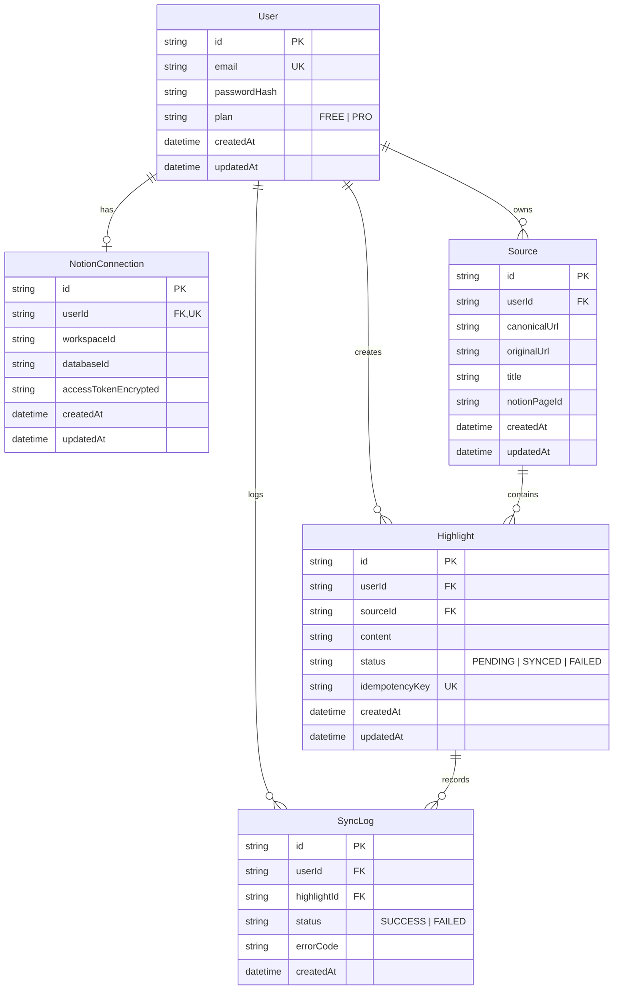

# Notion Highlight Sync — Database Design

## 1. Overview

The database is built on **PostgreSQL** and accessed using **Prisma ORM**. The data model isolates users, encrypts sensitive OAuth credentials, maps unique web sources per user, and records highlight entries with idempotency protection and audit logs.

---

## 2. Entity Relationship Diagram

---

## 3. Model Specifications & Constraints

### 3.1 User

- `id`: CUID or UUIDv4 (Primary Key)
- `email`: `VARCHAR(255)`, unique, indexed
- `passwordHash`: Argon2 or bcrypt hash string
- `plan`: Default `"FREE"`
- `createdAt`, `updatedAt`: Timestamps

### 3.2 NotionConnection

- `id`: CUID or UUIDv4 (Primary Key)
- `userId`: Foreign key to `User(id)` with unique constraint (1 connection per user for MVP)
- `workspaceId`: Notion workspace ID
- `databaseId`: Selected target database ID in Notion
- `accessTokenEncrypted`: AES-256-GCM encrypted token string
- `createdAt`, `updatedAt`: Timestamps

### 3.3 Source

- `id`: CUID or UUIDv4 (Primary Key)
- `userId`: Foreign key to `User(id)`
- `canonicalUrl`: Normalized URL string
- `originalUrl`: Exact captured URL string
- `title`: Page title string
- `notionPageId`: Notion Page ID
- **Unique Constraint:** `@@unique([userId, canonicalUrl])` ensuring one source page per user per canonical URL.

### 3.4 Highlight

- `id`: CUID or UUIDv4 (Primary Key)
- `userId`: Foreign key to `User(id)`
- `sourceId`: Foreign key to `Source(id)`
- `content`: `TEXT` content of the highlight
- `status`: Enum (`PENDING`, `SYNCED`, `FAILED`)
- `idempotencyKey`: UUIDv4, unique constraint `@@unique([idempotencyKey])`

### 3.5 SyncLog

- `id`: CUID or UUIDv4 (Primary Key)
- `userId`: Foreign key to `User(id)`
- `highlightId`: Foreign key to `Highlight(id)`
- `status`: Enum (`SUCCESS`, `FAILED`)
- `errorCode`: Nullable string identifying error category (`NOTION_RATE_LIMIT`, `PAGE_NOT_FOUND`, `AUTH_EXPIRED`, etc.)
- `createdAt`: Timestamp
