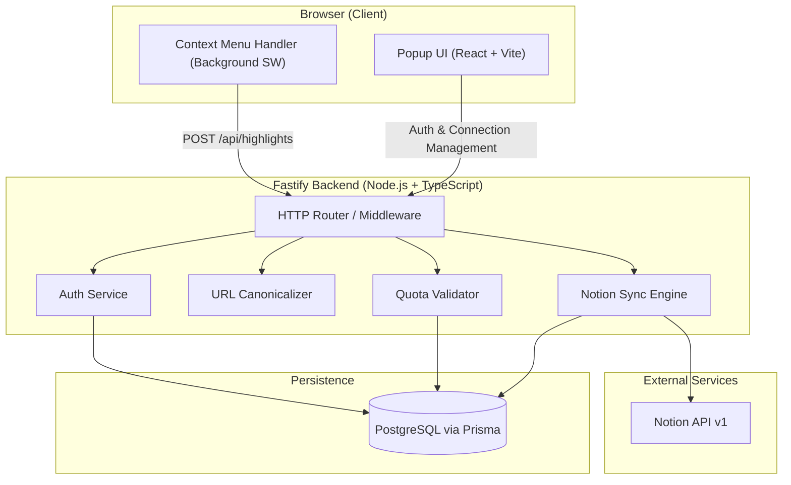

# Notion Highlight Sync — System Design

## 1. System Architecture

The system consists of three primary layers:

1. **Chrome Extension (Client):** Manifest V3 extension with React UI for authentication & settings, and background service worker for context menu interaction.
2. **Fastify Backend (API Server):** Stateless Node.js application handling session authentication, URL canonicalization, quota enforcement, and Notion API requests.
3. **PostgreSQL (Persistence):** Managed via Prisma ORM for relational state (Users, Notion Tokens, Sources, Highlights, Sync Logs).

---

## 2. Security Architecture

1. **Token Protection:** Notion OAuth tokens (`accessTokenEncrypted`) are encrypted at rest using AES-256-GCM. The encryption key is held only in the backend environment.
2. **No Client Secrets:** The Chrome Extension never sees or stores Notion access tokens or secrets.
3. **Session Derivation:** All backend endpoints determine user identity from a secure HTTP session / signed auth cookie. Requests cannot pass or spoof an arbitrary `userId`.
4. **Input Sanitization & Length Limits:** Every endpoint enforces strict Zod schema validation. Highlight text length is capped to protect Notion block size limits.
5. **No Secret Leaks in Logs:** Redaction rules ensure access tokens, passwords, and user highlight contents are omitted from server execution logs.
