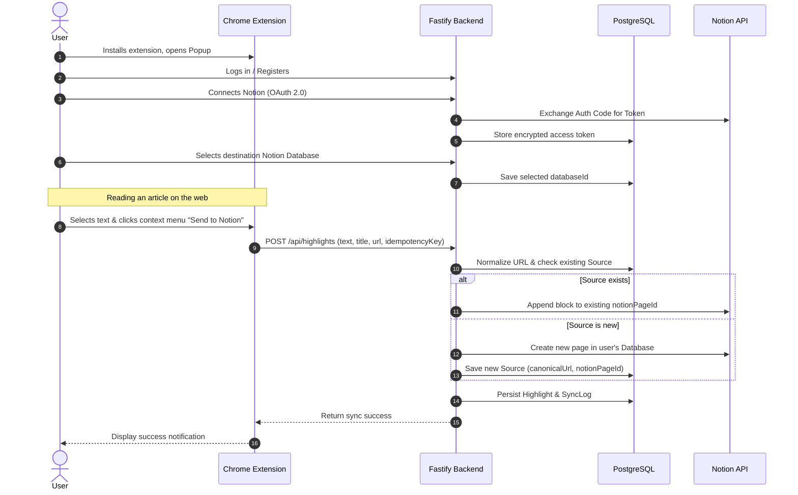

# Notion Highlight Sync — MVP Product Specification

## 1. Product Summary

**Notion Highlight Sync** is a lightweight productivity tool composed of a Chrome Extension and a Fastify Backend. It enables users reading articles, documentation, or news online to select text, right-click, and send the highlight directly to a specified Notion database. Highlights originating from the same article are automatically clustered under a single Notion page.

---

## 2. Core User Personas & Problems

- **Knowledge Workers & Researchers:** Frequently read online articles and want to store insights in Notion without having to manually copy-paste back and forth or create separate fragmented pages for every single quote.
- **Students & Lifelong Learners:** Need a fast, unobtrusive way to clip quotes while maintaining the source URL and article title.

---

## 3. End-to-End User Journey

---

## 4. Scope Boundaries

### In Scope for MVP

- **Chrome Extension (MV3):** Popup with Auth and Notion status, Context Menu on text selection, sync result notifications.
- **Backend API:** Fastify TypeScript server, session management, URL canonicalization, error handling, rate/quota guards.
- **PostgreSQL Database:** Prisma ORM for Users, NotionConnections, Sources, Highlights, and SyncLogs.
- **Notion Integration:** OAuth 2.0 flow, database picker, page creation, and block appending.
- **Free Quota:** Configurable highlight count per user.

### Out of Scope (Deferred to Post-MVP)

- AI summarization or auto-tagging
- Multi-browser extensions (Firefox, Safari)
- PDF highlight extraction
- Paid subscription / Stripe billing
- Background queues (BullMQ / Redis)
- Docker & CI/CD pipelines
