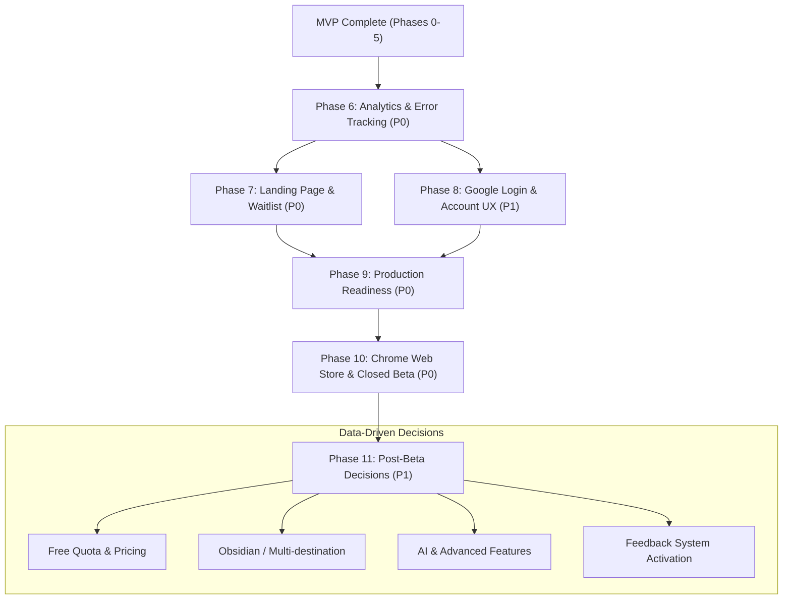

# Notion Highlight Sync — Post-MVP Master Roadmap

Tài liệu này tổng hợp chiến lược phát triển từ **Phase 6 đến Phase 11**, đưa sản phẩm từ trạng thái MVP hoàn thiện sang sản phẩm SaaS sẵn sàng đưa lên **Chrome Web Store**, triển khai **Closed Beta** và chuẩn bị thương mại hóa dựa trên dữ liệu thực tế.

---

## 1. Tổng quan các giai đoạn (Phase Lifecycle)

| Phase        | Tên giai đoạn                                                                                                  | Mục tiêu chính                                                 | Mức độ ưu tiên            | Tài liệu chi tiết                                                                                                         |
| ------------ | -------------------------------------------------------------------------------------------------------------- | -------------------------------------------------------------- | ------------------------- | ------------------------------------------------------------------------------------------------------------------------- |
| **Phase 6**  | [Analytics & Error Tracking](file:///d:/dhd/notion-highlight/docs/roadmap/phase-6-analytics-error-tracking.md) | Đo lường phễu chuyển đổi, retention và giám sát lỗi bảo mật    | **P0** (Nên làm đầu tiên) | [`phase-6-analytics-error-tracking.md`](file:///d:/dhd/notion-highlight/docs/roadmap/phase-6-analytics-error-tracking.md) |
| **Phase 7**  | [Landing Page & Validation](file:///d:/dhd/notion-highlight/docs/roadmap/phase-7-landing-page-validation.md)   | Xây dựng kênh giới thiệu, truyền thông và thu thập Waitlist    | **P0** (Trước Beta)       | [`phase-7-landing-page-validation.md`](file:///d:/dhd/notion-highlight/docs/roadmap/phase-7-landing-page-validation.md)   |
| **Phase 8**  | [Google Login & Account UX](file:///d:/dhd/notion-highlight/docs/roadmap/phase-8-google-login-account.md)      | Giảm friction onboarding, hoàn thiện quản lý tài khoản         | **P1** (Trước Public)     | [`phase-8-google-login-account.md`](file:///d:/dhd/notion-highlight/docs/roadmap/phase-8-google-login-account.md)         |
| **Phase 9**  | [Production Readiness](file:///d:/dhd/notion-highlight/docs/roadmap/phase-9-production-readiness.md)           | Hạ tầng production, HTTPS, security review, legal              | **P0** (Trước Release)    | [`phase-9-production-readiness.md`](file:///d:/dhd/notion-highlight/docs/roadmap/phase-9-production-readiness.md)         |
| **Phase 10** | [Chrome Web Store & Closed Beta](file:///d:/dhd/notion-highlight/docs/roadmap/phase-10-chrome-release-beta.md) | Publish extension lên store, chạy beta với 5–10 user thật      | **P0** (Release Gate)     | [`phase-10-chrome-release-beta.md`](file:///d:/dhd/notion-highlight/docs/roadmap/phase-10-chrome-release-beta.md)         |
| **Phase 11** | [Post-Beta Product Decisions](file:///d:/dhd/notion-highlight/docs/roadmap/phase-11-post-beta-decisions.md)    | Quyết định pricing, free quota và nền tảng tiếp theo theo data | **P1** (Sau Beta)         | [`phase-11-post-beta-decisions.md`](file:///d:/dhd/notion-highlight/docs/roadmap/phase-11-post-beta-decisions.md)         |

---

## 2. Luồng phụ thuộc & Thứ tự thực hiện (Dependency Graph)

---

## 3. Kế hoạch triển khai theo Batch (Batch Execution Plan)

Để tiến hành hiệu quả cùng coding agent, công việc được chia làm 6 batches:

### **Batch 1 — Tracking & Error Monitoring (Phase 6)**

- Tích hợp PostHog và định nghĩa Event Taxonomy (`user_registered`, `notion_connected`, `highlight_saved`, v.v.).
- Tích hợp Sentry cho Backend và Extension với bộ lọc tẩy sạch bí mật (Secrets/PII scrubbing).
- _Lưu ý:_ Phân hệ Feedback trong app được tạm hoãn đến sau khi hệ thống vận hành trên Production.

### **Batch 2 — Landing Page, Survey & Beta Waitlist (Phase 7)**

- Xây dựng Landing page giới thiệu core workflow gom nhóm trích dẫn.
- Form đăng ký Waitlist thu thập nhu cầu tester.
- Tracking chuyển đổi landing page bằng PostHog từ Batch 1.

### **Batch 3 — Google Login & Account Management (Phase 8)**

- Đăng nhập/Đăng ký 1-click bằng Google OAuth.
- Màn hình cài đặt tài khoản, chuyển đổi database Notion, ngắt kết nối và xóa tài khoản.

### **Batch 4 — Production Environment, Security & Legal (Phase 9)**

- Thiết lập Backend, Database Production, Custom Domain, HTTPS và OAuth callbacks.
- Kiểm toán bảo mật cách ly dữ liệu user, mã hóa AES-256-GCM token Notion.
- Công bố Privacy Policy và Terms of Service.

### **Batch 5 — Chrome Web Store Submission & Closed Beta (Phase 10)**

- Đóng gói extension, chuẩn bị screenshots, giải trình quyền hạn và submit lên Google.
- Smoke test bản cài đặt từ CWS trên profile mới.
- Khởi động Closed Beta với 5–10 người dùng thật từ danh sách Waitlist.

### **Batch 6 — Đánh giá dữ liệu Beta & Quyết định kế tiếp (Phase 11)**

- Phân tích phễu chuyển đổi, retention, phân bổ số lượng highlight.
- Chốt chính sách gói miễn phí (Free Quota) và gói trả phí (Pro Plan).
- Kích hoạt form Feedback và quyết định tích hợp tiếp theo (Obsidian, AI, PDF).

---

## 4. Định hướng chiến lược cốt lõi

1. **Đo lường trước, tính năng sau:** Cài đặt analytics & error tracking sớm giúp nhìn thấy bức tranh tổng thể ngay từ landing page và những lượt dùng đầu tiên.
2. **Không vội làm feedback khi chưa có user:** Hệ thống feedback chỉ thực sự hữu ích khi đã có lượng người dùng đều đặn trên production.
3. **Monetization dựa trên hành vi thực tế:** Không phỏng đoán mức giá hay giới hạn free quota khi chưa có số liệu tần suất bôi đen của beta testers.
